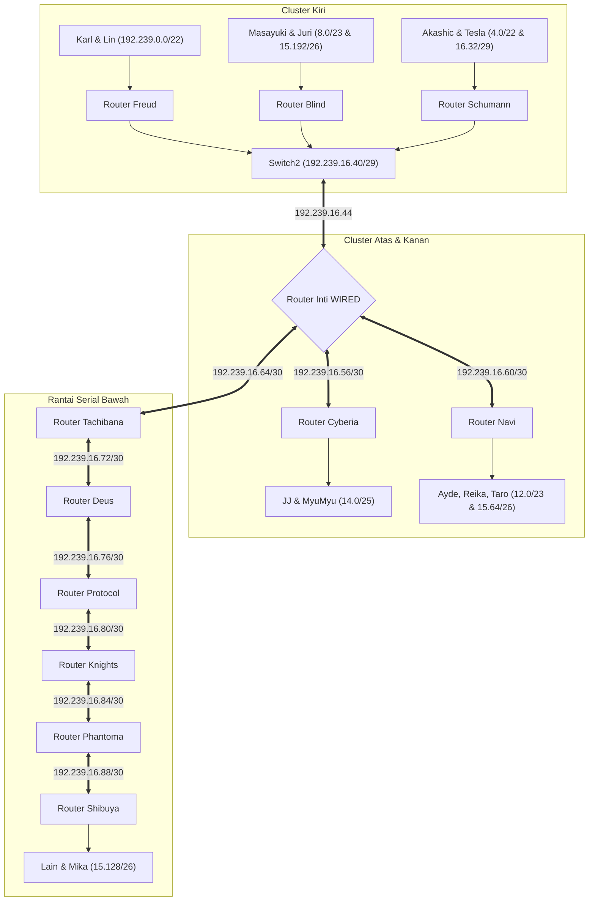

# Jarkom-Modul-4-2026-K-56

| No  | Nama                           | NRP        | Pengerjaan |
| --- | ------------------------------ | ---------- | ---------- |
| 1   | Muhammmad Ridwan               | 5027251113 | No 1-10    |
| 2   | Sahira Bilqis Rivadito         | 5027251037 | No 11-20   |

## LAPORAN RESMI MODUL 4
### Subnetting VLSM & Static Routing (Cisco Packet Tracer)

---

## 1. Desain Topologi

Topologi dibangun menggunakan perangkat lunak **Cisco Packet Tracer** dengan file konfigurasi utama `Modul4_Kelompok56_CPT.pkt`. Seluruh node dihubungkan sesuai hierarki jaringan dengan router seri Cisco 2811, switch seri 2960 / Switch-PT, cloud interkoneksi eksternal, dan berbagai host klien (PC, Laptop, dan Server).


## 2. Inventaris Node dan Perangkat Jaringan

Jaringan terdiri dari 13 Router Cisco 2811, 13 Switch, 1 Cloud WAN, serta 21 end-device dengan kebutuhan jumlah host bervariasi:

| Kategori | Nama Node / Perangkat | Fungsi / Peran | Koneksi Antarmuka |
|---|---|---|---|
| **Core Router** | `Wired` | Router inti penghubung seluruh cluster jaringan | Fa0/0, Fa0/1, Fa1/0, Fa1/1 |
| **Cluster Kiri** | `Freud` | Router gateway LAN Karl & Lin | Fa0/0 (ke Switch2), Fa0/1 (ke Switch3) |
| | `Blind` | Router gateway Masayuki & Juri | Fa0/0 (ke Switch2), Fa0/1 (Juri), Fa1/0 (Switch4) |
| | `Schumann` | Router gateway Akashic & penghubung Tesla | Fa0/0 (Switch2), Fa0/1 (Akashic), Fa1/0 (Tesla) |
| | `Tesla` | Router gateway LAN Omnipresence & Denpa | Fa0/0 (Schumann), Fa0/1 (Switch5) |
| **Cluster Atas & Kanan** | `Cyberia` | Router gateway club Cyberia & uplink Cloud | Fa0/0 (Cloud WAN), Fa0/1 (Switch1), Fa1/0 (Wired) |
| | `Navi` | Router gateway cluster terminal Navi | Fa0/0 (Wired), Fa0/1 (Switch9), Fa1/0 (Switch6), Fa1/1 (Switch7) |
| **Rantai Serial Bawah** | `Tachibana` | Router gateway Collective & Ghost | Fa0/0 (Wired), Fa0/1 (Deus), Fa1/0 (Switch8) |
| | `Deus` | Router gateway Lilith & Specter | Fa0/0 (Tachibana), Fa0/1 (Switch10), Fa1/0 (Protocol) |
| | `Protocol` | Router gateway Chisa & Hodgeson | Fa0/0 (Deus), Fa0/1 (Switch11), Fa1/0 (Knights) |
| | `Knights` | Router gateway Server Eiri | Fa0/0 (Protocol), Fa0/1 (Phantoma), Fa1/0 (Eiri) |
| | `Phantoma` | Router gateway Semi | Fa0/0 (Knights), Fa0/1 (Shibuya), Fa1/0 (Switch12) |
| | `Shibuya` | Router gateway LAN residensial Lain & Mika | Fa0/0 (Phantoma), Fa0/1 (Switch13) |

---

# SOAL 1 | ANALISIS KEBUTUHAN HOST & PEMBAGIAN SUBNET

Kelompok: K56 | Prefix IP: `192.239.0.0/16`

> Lakukan inventarisasi dan analisis kebutuhan kapasitas alamat IP pada setiap subnet LAN serta link antar-router di dalam topologi. Urutkan kebutuhan kapasitas host dari yang terbesar hingga terkecil sebagai fondasi perhitungan Variable Length Subnet Masking (VLSM).

## 1. Analisis Kebutuhan Host per Subnet

Sesuai prinsip efisiensi pengalamatan IPv4 menggunakan metode **VLSM (Variable Length Subnet Masking)**, pengalokasian blok subnet harus diurutkan secara menurun (*descending*) berdasarkan jumlah host yang dibutuhkan. Setiap subnet memerlukan tambahan alamat untuk *Network ID*, *Broadcast Address*, dan antarmuka *Default Gateway* router.

Rumus penentuan ukuran blok alamat adalah:
Kapasitas Blok = 2^n ≥ (Jumlah Host + Jumlah Interface Router + 2)

| No | Label Subnet | Anggota Host / Interkoneksi | Kebutuhan Host Riil | Ukuran Blok Minimum | Netmask / Prefix |
|---|---|---|---|---|---|
| 1 | Subnet A1 | Karl (700 host) + Lin (180 host) | 880 host | 1024 IP | `255.255.252.0` (`/22`) |
| 2 | Subnet A2 | Omnipresence (510 host) + Denpa (3 host) | 513 host | 1024 IP | `255.255.252.0` (`/22`) |
| 3 | Subnet B1 | Masayuki (300 host) | 300 host | 512 IP | `255.255.254.0` (`/23`) |
| 4 | Subnet B2 | Collective (260 host) + Ghost (6 host) | 266 host | 512 IP | `255.255.254.0` (`/23`) |
| 5 | Subnet C1 | Ayde (208 host) + Reika (45 host) + Yasuo/Miho/Kuma | 253+ host | 512 IP | `255.255.254.0` (`/23`) |
| 6 | Subnet D1 | JJ (95 host) + MyuMyu (30 host) | 125 host | 128 IP | `255.255.255.128` (`/25`) |
| 7 | Subnet D2 | Lilith (77 host) + Specter (21 host) | 98 host | 128 IP | `255.255.255.128` (`/25`) |
| 8 | Subnet E1 | Chisa (23 host) + Hodgeson (9 host) | 32 host | 64 IP | `255.255.255.192` (`/26`) |
| 9 | Subnet E2 | Taro (57 host) | 57 host | 64 IP | `255.255.255.192` (`/26`) |
| 10 | Subnet E3 | Lain (57 host) + Mika (4 host) | 61 host | 64 IP | `255.255.255.192` (`/26`) |
| 11 | Subnet E4 | Juri (31 host) | 31 host | 64 IP | `255.255.255.192` (`/26`) |
| 12 | Subnet F1 | Semi (14 host) | 14 host | 32 IP | `255.255.255.224` (`/27`) |
| 13 | Subnet G1 | Akashic (3 host) | 3 host | 8 IP | `255.255.255.248` (`/29`) |
| 14 | Subnet G2 | Interkoneksi Switch2 (Wired, Freud, Blind, Schumann) | 4 router | 8 IP | `255.255.255.248` (`/29`) |
| 15 | Subnet G3 | Eiri (2 host) | 2 host | 8 IP | `255.255.255.248` (`/29`) |
| 16 | Subnet H1 | Point-to-Point Link Wired ↔ Cyberia | 2 router | 4 IP | `255.255.255.252` (`/30`) |
| 17 | Subnet H2 | Point-to-Point Link Wired ↔ Navi | 2 router | 4 IP | `255.255.255.252` (`/30`) |
| 18 | Subnet H3 | Point-to-Point Link Wired ↔ Tachibana | 2 router | 4 IP | `255.255.255.252` (`/30`) |
| 19 | Subnet H4 | Point-to-Point Link Schumann ↔ Tesla | 2 router | 4 IP | `255.255.255.252` (`/30`) |
| 20 | Subnet H5 | Point-to-Point Link Tachibana ↔ Deus | 2 router | 4 IP | `255.255.255.252` (`/30`) |
| 21 | Subnet H6 | Point-to-Point Link Deus ↔ Protocol | 2 router | 4 IP | `255.255.255.252` (`/30`) |
| 22 | Subnet H7 | Point-to-Point Link Protocol ↔ Knights | 2 router | 4 IP | `255.255.255.252` (`/30`) |
| 23 | Subnet H8 | Point-to-Point Link Knights ↔ Phantoma | 2 router | 4 IP | `255.255.255.252` (`/30`) |
| 24 | Subnet H9 | Point-to-Point Link Phantoma ↔ Shibuya | 2 router | 4 IP | `255.255.255.252` (`/30`) |

---

# SOAL 2 | PERHITUNGAN SUBNETTING VLSM

Kelompok: K56 | Prefix IP: `192.239.0.0/16`

> Turunkan pohon subnetting (VLSM Tree) dari blok alamat induk kelompok K56 `192.239.0.0/16`. Tentukan alokasi Network Address, Subnet Mask, Range IP Usable, dan Broadcast Address secara matematis sehingga seluruh kebutuhan terpenuhi tanpa pemborosan (*zero address wastage*) dan tanpa overlap.

## 1. Pohon Alokasi Subnetting (VLSM Tree)

Pembagian pohon subnet dari prefix dasar `192.239.0.0/19` (blok 8192 alamat):

```text
192.239.0.0/19 (8192 IP)
├── 192.239.0.0/21 (2048 IP)
│   ├── 192.239.0.0/22   --> Subnet A1 (Karl & Lin: 880 host)
│   └── 192.239.4.0/22   --> Subnet A2 (Omnipresence & Denpa: 513 host)
├── 192.239.8.0/21 (2048 IP)
│   ├── 192.239.8.0/23   --> Subnet B1 (Masayuki: 300 host)
│   ├── 192.239.10.0/23  --> Subnet B2 (Collective & Ghost: 266 host)
│   └── 192.239.12.0/22 (1024 IP)
│       ├── 192.239.12.0/23  --> Subnet C1 (Ayde, Reika, Yasuo, Miho, Kuma)
│       └── 192.239.14.0/23 (512 IP)
│           ├── 192.239.14.0/24 (256 IP)
│           │   ├── 192.239.14.0/25   --> Subnet D1 (JJ & MyuMyu: 125 host)
│           │   └── 192.239.14.128/25 --> Subnet D2 (Lilith & Specter: 98 host)
│           └── 192.239.15.0/24 (256 IP)
│               ├── 192.239.15.0/26   --> Subnet E1 (Chisa & Hodgeson: 32 host)
│               ├── 192.239.15.64/26  --> Subnet E2 (Taro: 57 host)
│               ├── 192.239.15.128/26 --> Subnet E3 (Lain & Mika: 61 host)
│               └── 192.239.15.192/26 --> Subnet E4 (Juri: 31 host)
└── 192.239.16.0/21 (2048 IP)
    └── 192.239.16.0/24 (256 IP)
        ├── 192.239.16.0/27  --> Subnet F1 (Semi: 14 host)
        ├── 192.239.16.32/27 (32 IP)
        │   ├── 192.239.16.32/29 --> Subnet G1 (Akashic: 3 host)
        │   ├── 192.239.16.40/29 --> Subnet G2 (Interkoneksi Switch2: 4 router)
        │   ├── 192.239.16.48/29 --> Subnet G3 (Eiri: 2 host)
        │   └── 192.239.16.56/29 (8 IP)
        │       ├── 192.239.16.56/30 --> Subnet H1 (Wired <-> Cyberia)
        │       └── 192.239.16.60/30 --> Subnet H2 (Wired <-> Navi)
        └── 192.239.16.64/27 (32 IP)
            ├── 192.239.16.64/30 --> Subnet H3 (Wired <-> Tachibana)
            ├── 192.239.16.68/30 --> Subnet H4 (Schumann <-> Tesla)
            ├── 192.239.16.72/30 --> Subnet H5 (Tachibana <-> Deus)
            ├── 192.239.16.76/30 --> Subnet H6 (Deus <-> Protocol)
            ├── 192.239.16.80/30 --> Subnet H7 (Protocol <-> Knights)
            ├── 192.239.16.84/30 --> Subnet H8 (Knights <-> Phantoma)
            └── 192.239.16.88/30 --> Subnet H9 (Phantoma <-> Shibuya)
```

## 2. Tabel Lengkap Alokasi Pengalamatan IP Jaringan

| Nama Subnet | Network Address | Netmask | Range Usable IP | Broadcast Address | Gateway Router & Antarmuka |
|---|---|---|---|---|---|
| **Subnet A1** | `192.239.0.0/22` | `255.255.252.0` | `192.239.0.1` – `192.239.3.254` | `192.239.3.255` | `192.239.0.1` (Freud Fa0/1) |
| **Subnet A2** | `192.239.4.0/22` | `255.255.252.0` | `192.239.4.1` – `192.239.7.254` | `192.239.7.255` | `192.239.4.1` (Tesla Fa0/1) |
| **Subnet B1** | `192.239.8.0/23` | `255.255.254.0` | `192.239.8.1` – `192.239.9.254` | `192.239.9.255` | `192.239.8.1` (Blind Fa1/0) |
| **Subnet B2** | `192.239.10.0/23` | `255.255.254.0` | `192.239.10.1` – `192.239.11.254` | `192.239.11.255` | `192.239.10.1` (Tachibana Fa1/0) |
| **Subnet C1** | `192.239.12.0/23` | `255.255.254.0` | `192.239.12.1` – `192.239.13.254` | `192.239.13.255` | `192.239.12.1` / `13.1` (Navi) |
| **Subnet D1** | `192.239.14.0/25` | `255.255.255.128` | `192.239.14.1` – `192.239.14.126` | `192.239.14.127` | `192.239.14.1` (Cyberia Fa0/1) |
| **Subnet D2** | `192.239.14.128/25` | `255.255.255.128` | `192.239.14.129` – `192.239.14.254` | `192.239.14.255` | `192.239.14.129` (Deus Fa0/1) |
| **Subnet E1** | `192.239.15.0/26` | `255.255.255.192` | `192.239.15.1` – `192.239.15.62` | `192.239.15.63` | `192.239.15.1` (Protocol Fa0/1) |
| **Subnet E2** | `192.239.15.64/26` | `255.255.255.192` | `192.239.15.65` – `192.239.15.126` | `192.239.15.127` | `192.239.15.65` (Navi Fa1/1) |
| **Subnet E3** | `192.239.15.128/26` | `255.255.255.192` | `192.239.15.129` – `192.239.15.190` | `192.239.15.191` | `192.239.15.129` (Shibuya Fa0/1) |
| **Subnet E4** | `192.239.15.192/26` | `255.255.255.192` | `192.239.15.193` – `192.239.15.254` | `192.239.15.255` | `192.239.15.193` (Blind Fa0/1) |
| **Subnet F1** | `192.239.16.0/27` | `255.255.255.224` | `192.239.16.1` – `192.239.16.30` | `192.239.16.31` | `192.239.16.1` (Phantoma Fa1/0) |
| **Subnet G1** | `192.239.16.32/29` | `255.255.255.248` | `192.239.16.33` – `192.239.16.38` | `192.239.16.39` | `192.239.16.33` (Schumann Fa0/1) |
| **Subnet G2** | `192.239.16.40/29` | `255.255.255.248` | `192.239.16.41` – `192.239.16.46` | `192.239.16.47` | Switch2 Multi-Router Transit |
| **Subnet G3** | `192.239.16.48/29` | `255.255.255.248` | `192.239.16.49` – `192.239.16.54` | `192.239.16.55` | `192.239.16.49` (Knights Fa1/0) |
| **Subnet H1** | `192.239.16.56/30` | `255.255.255.252` | `192.239.16.57` – `192.239.16.58` | `192.239.16.59` | Wired Fa0/0 ↔ Cyberia Fa1/0 |
| **Subnet H2** | `192.239.16.60/30` | `255.255.255.252` | `192.239.16.61` – `192.239.16.62` | `192.239.16.63` | Wired Fa1/0 ↔ Navi Fa0/0 |
| **Subnet H3** | `192.239.16.64/30` | `255.255.255.252` | `192.239.16.65` – `192.239.16.66` | `192.239.16.67` | Wired Fa0/1 ↔ Tachibana Fa0/0 |
| **Subnet H4** | `192.239.16.68/30` | `255.255.255.252` | `192.239.16.69` – `192.239.16.70` | `192.239.16.71` | Schumann Fa1/0 ↔ Tesla Fa0/0 |
| **Subnet H5** | `192.239.16.72/30` | `255.255.255.252` | `192.239.16.73` – `192.239.16.74` | `192.239.16.75` | Tachibana Fa0/1 ↔ Deus Fa0/0 |
| **Subnet H6** | `192.239.16.76/30` | `255.255.255.252` | `192.239.16.77` – `192.239.16.78` | `192.239.16.79` | Deus Fa1/0 ↔ Protocol Fa0/0 |
| **Subnet H7** | `192.239.16.80/30` | `255.255.255.252` | `192.239.16.81` – `192.239.16.82` | `192.239.16.83` | Protocol Fa1/0 ↔ Knights Fa0/0 |
| **Subnet H8** | `192.239.16.84/30` | `255.255.255.252` | `192.239.16.85` – `192.239.16.86` | `192.239.16.87` | Knights Fa0/1 ↔ Phantoma Fa0/0 |
| **Subnet H9** | `192.239.16.88/30` | `255.255.255.252` | `192.239.16.89` – `192.239.16.90` | `192.239.16.91` | Phantoma Fa0/1 ↔ Shibuya Fa0/0 |

---

# SOAL 3 | SUBNETTING INTERKONEKSI ROUTER

Kelompok: K56 | Prefix IP: `192.239.0.0/16`

> Rancang skema pengalamatan khusus untuk interkoneksi multi-router pada Switch2 (`192.239.16.40/29`) serta 9 tautan point-to-point serial/ethernet (`/30`). Jelaskan pembagian alamat IP pada masing-masing antarmuka router yang saling berhadapan.

## 1. Subnet Interkoneksi Multi-Router (Switch2)

Switch2 berfungsi sebagai segmen broadcast transit yang mempertemukan empat router: router inti `Wired`, router `Freud`, router `Blind`, dan router `Schumann`. Subnet yang digunakan adalah `192.239.16.40/29` (Netmask `255.255.255.248`), dengan 6 IP usable (`192.239.16.41` s.d. `192.239.16.46`):

| Router | Port Antarmuka | Alamat IP | Subnet Mask | Keterangan |
|---|---|---|---|---|
| `Freud` | FastEthernet0/0 | `192.239.16.41` | `255.255.255.248` | Terhubung ke Switch2 Fa2/1 |
| `Blind` | FastEthernet0/0 | `192.239.16.42` | `255.255.255.248` | Terhubung ke Switch2 Fa1/1 |
| `Schumann` | FastEthernet0/0 | `192.239.16.43` | `255.255.255.248` | Terhubung ke Switch2 Fa3/1 |
| `Wired` | FastEthernet1/1 | `192.239.16.44` | `255.255.255.248` | Terhubung ke Switch2 Fa0/1 (Core Transit) |

## 2. Subnet Point-to-Point Link Antar-Router (/30)

Setiap link antar-router hanya memerlukan 2 host IP usable sehingga menggunakan subnet berukuran `/30` (`255.255.255.252`):

| Nama Link | Subnet ID | Router Sisi A (IP & Port) | Router Sisi B (IP & Port) |
|---|---|---|---|
| Link H1 | `192.239.16.56/30` | `Cyberia` Fa1/0: `192.239.16.57` | `Wired` Fa0/0: `192.239.16.58` |
| Link H2 | `192.239.16.60/30` | `Wired` Fa1/0: `192.239.16.61` | `Navi` Fa0/0: `192.239.16.62` |
| Link H3 | `192.239.16.64/30` | `Wired` Fa0/1: `192.239.16.65` | `Tachibana` Fa0/0: `192.239.16.66` |
| Link H4 | `192.239.16.68/30` | `Schumann` Fa1/0: `192.239.16.69` | `Tesla` Fa0/0: `192.239.16.70` |
| Link H5 | `192.239.16.72/30` | `Tachibana` Fa0/1: `192.239.16.73` | `Deus` Fa0/0: `192.239.16.74` |
| Link H6 | `192.239.16.76/30` | `Deus` Fa1/0: `192.239.16.77` | `Protocol` Fa0/0: `192.239.16.78` |
| Link H7 | `192.239.16.80/30` | `Protocol` Fa1/0: `192.239.16.81` | `Knights` Fa0/0: `192.239.16.82` |
| Link H8 | `192.239.16.84/30` | `Knights` Fa0/1: `192.239.16.85` | `Phantoma` Fa0/0: `192.239.16.86` |
| Link H9 | `192.239.16.88/30` | `Phantoma` Fa0/1: `192.239.16.89` | `Shibuya` Fa0/0: `192.239.16.90` |

---

# SOAL 4 | PENGALAMATAN IP ROUTER INTI (WIRED)

Kelompok: K56 | Prefix IP: `192.239.0.0/16`

> Konfigurasikan seluruh antarmuka pada router inti `Wired` sesuai dengan tabel alokasi IP. Aktifkan setiap antarmuka dan pastikan status koneksi berada dalam kondisi `up/up`.

## 1. Konfigurasi Antarmuka Router Wired

Router `Wired` memiliki 4 port FastEthernet aktif:
- `FastEthernet0/0`: Menuju router `Cyberia`
- `FastEthernet0/1`: Menuju router `Tachibana`
- `FastEthernet1/0`: Menuju router `Navi`
- `FastEthernet1/1`: Menuju `Switch2` (transit multi-router)

Perintah konfigurasi Cisco IOS pada router `Wired`:

```text
Wired> enable
Wired# configure terminal
Wired(config)# hostname Wired

Wired(config)# interface FastEthernet0/0
Wired(config-if)# description Link to Cyberia Fa1/0
Wired(config-if)# ip address 192.239.16.58 255.255.255.252
Wired(config-if)# no shutdown
Wired(config-if)# exit

Wired(config)# interface FastEthernet0/1
Wired(config-if)# description Link to Tachibana Fa0/0
Wired(config-if)# ip address 192.239.16.65 255.255.255.252
Wired(config-if)# no shutdown
Wired(config-if)# exit

Wired(config)# interface FastEthernet1/0
Wired(config-if)# description Link to Navi Fa0/0
Wired(config-if)# ip address 192.239.16.61 255.255.255.252
Wired(config-if)# no shutdown
Wired(config-if)# exit

Wired(config)# interface FastEthernet1/1
Wired(config-if)# description Multi-Router Transit via Switch2
Wired(config-if)# ip address 192.239.16.44 255.255.255.248
Wired(config-if)# no shutdown
Wired(config-if)# exit
```

---

# SOAL 5 | PENGALAMATAN IP CLUSTER ROUTER KIRI

Kelompok: K56 | Prefix IP: `192.239.0.0/16`

> Terapkan konfigurasi antarmuka IP pada seluruh router di cluster kiri: `Freud`, `Blind`, `Schumann`, dan `Tesla`. Hubungkan router ke switch LAN klien masing-masing dan aktifkan antarmuka penghubung.

## 1. Konfigurasi Router Freud

```text
Freud(config)# interface FastEthernet0/0
Freud(config-if)# ip address 192.239.16.41 255.255.255.248
Freud(config-if)# no shutdown
Freud(config-if)# exit

Freud(config)# interface FastEthernet0/1
Freud(config-if)# description Gateway Karl & Lin (Subnet A1)
Freud(config-if)# ip address 192.239.0.1 255.255.252.0
Freud(config-if)# no shutdown
Freud(config-if)# exit
```

## 2. Konfigurasi Router Blind

```text
Blind(config)# interface FastEthernet0/0
Blind(config-if)# ip address 192.239.16.42 255.255.255.248
Blind(config-if)# no shutdown
Blind(config-if)# exit

Blind(config)# interface FastEthernet0/1
Blind(config-if)# description Gateway Juri (Subnet E4)
Blind(config-if)# ip address 192.239.15.193 255.255.255.192
Blind(config-if)# no shutdown
Blind(config-if)# exit

Blind(config)# interface FastEthernet1/0
Blind(config-if)# description Gateway Masayuki (Subnet B1)
Blind(config-if)# ip address 192.239.8.1 255.255.254.0
Blind(config-if)# no shutdown
Blind(config-if)# exit
```

## 3. Konfigurasi Router Schumann

```text
Schumann(config)# interface FastEthernet0/0
Schumann(config-if)# ip address 192.239.16.43 255.255.255.248
Schumann(config-if)# no shutdown
Schumann(config-if)# exit

Schumann(config)# interface FastEthernet0/1
Schumann(config-if)# description Gateway Akashic (Subnet G1)
Schumann(config-if)# ip address 192.239.16.33 255.255.255.248
Schumann(config-if)# no shutdown
Schumann(config-if)# exit

Schumann(config)# interface FastEthernet1/0
Schumann(config-if)# description Link to Tesla Fa0/0 (Subnet H4)
Schumann(config-if)# ip address 192.239.16.69 255.255.255.252
Schumann(config-if)# no shutdown
Schumann(config-if)# exit
```

## 4. Konfigurasi Router Tesla

```text
Tesla(config)# interface FastEthernet0/0
Tesla(config-if)# description Link to Schumann Fa1/0 (Subnet H4)
Tesla(config-if)# ip address 192.239.16.70 255.255.255.252
Tesla(config-if)# no shutdown
Tesla(config-if)# exit

Tesla(config)# interface FastEthernet0/1
Tesla(config-if)# description Gateway Omnipresence & Denpa (Subnet A2)
Tesla(config-if)# ip address 192.239.4.1 255.255.252.0
Tesla(config-if)# no shutdown
Tesla(config-if)# exit
```

---

# SOAL 6 | PENGALAMATAN IP ROUTER ATAS & KANAN

Kelompok: K56 | Prefix IP: `192.239.0.0/16`

> Konfigurasikan antarmuka pada router `Cyberia` (termasuk uplink WAN) dan router `Navi` yang melayani beberapa segmen terminal (Ayde, Reika, Taro, Yasuo, Miho, Kuma).

## 1. Konfigurasi Router Cyberia

```text
Cyberia(config)# interface FastEthernet0/1
Cyberia(config-if)# description Gateway JJ & MyuMyu (Subnet D1)
Cyberia(config-if)# ip address 192.239.14.1 255.255.255.128
Cyberia(config-if)# no shutdown
Cyberia(config-if)# exit

Cyberia(config)# interface FastEthernet1/0
Cyberia(config-if)# description Link to Wired Fa0/0 (Subnet H1)
Cyberia(config-if)# ip address 192.239.16.57 255.255.255.252
Cyberia(config-if)# no shutdown
Cyberia(config-if)# exit
```

## 2. Konfigurasi Router Navi

```text
Navi(config)# interface FastEthernet0/0
Navi(config-if)# description Link to Wired Fa1/0 (Subnet H2)
Navi(config-if)# ip address 192.239.16.62 255.255.255.252
Navi(config-if)# no shutdown
Navi(config-if)# exit

Navi(config)# interface FastEthernet1/0
Navi(config-if)# description Gateway Ayde & Reika (Subnet C1)
Navi(config-if)# ip address 192.239.12.1 255.255.254.0
Navi(config-if)# no shutdown
Navi(config-if)# exit

Navi(config)# interface FastEthernet1/1
Navi(config-if)# description Gateway Taro (Subnet E2)
Navi(config-if)# ip address 192.239.15.65 255.255.255.192
Navi(config-if)# no shutdown
Navi(config-if)# exit

Navi(config)# interface FastEthernet0/1
Navi(config-if)# description Gateway Yasuo, Miho, Kuma
Navi(config-if)# ip address 192.239.13.1 255.255.254.0
Navi(config-if)# no shutdown
Navi(config-if)# exit
```

---

# SOAL 7 | PENGALAMATAN IP ROUTER RANTAI BAWAH

Kelompok: K56 | Prefix IP: `192.239.0.0/16`

> Konfigurasikan antarmuka pada router rantai serial bawah: `Tachibana`, `Deus`, `Protocol`, dan `Knights`. Setiap router melayani antarmuka point-to-point dan antarmuka LAN lokal.

## 1. Konfigurasi Router Tachibana

```text
Tachibana(config)# interface FastEthernet0/0
Tachibana(config-if)# description Link to Wired Fa0/1 (Subnet H3)
Tachibana(config-if)# ip address 192.239.16.66 255.255.255.252
Tachibana(config-if)# no shutdown
Tachibana(config-if)# exit

Tachibana(config)# interface FastEthernet0/1
Tachibana(config-if)# description Link to Deus Fa0/0 (Subnet H5)
Tachibana(config-if)# ip address 192.239.16.73 255.255.255.252
Tachibana(config-if)# no shutdown
Tachibana(config-if)# exit

Tachibana(config)# interface FastEthernet1/0
Tachibana(config-if)# description Gateway Collective & Ghost (Subnet B2)
Tachibana(config-if)# ip address 192.239.10.1 255.255.254.0
Tachibana(config-if)# no shutdown
Tachibana(config-if)# exit
```

## 2. Konfigurasi Router Deus

```text
Deus(config)# interface FastEthernet0/0
Deus(config-if)# description Link to Tachibana Fa0/1 (Subnet H5)
Deus(config-if)# ip address 192.239.16.74 255.255.255.252
Deus(config-if)# no shutdown
Deus(config-if)# exit

Deus(config)# interface FastEthernet0/1
Deus(config-if)# description Gateway Lilith & Specter (Subnet D2)
Deus(config-if)# ip address 192.239.14.129 255.255.255.128
Deus(config-if)# no shutdown
Deus(config-if)# exit

Deus(config)# interface FastEthernet1/0
Deus(config-if)# description Link to Protocol Fa0/0 (Subnet H6)
Deus(config-if)# ip address 192.239.16.77 255.255.255.252
Deus(config-if)# no shutdown
Deus(config-if)# exit
```

## 3. Konfigurasi Router Protocol

```text
Protocol(config)# interface FastEthernet0/0
Protocol(config-if)# description Link to Deus Fa1/0 (Subnet H6)
Protocol(config-if)# ip address 192.239.16.78 255.255.255.252
Protocol(config-if)# no shutdown
Protocol(config-if)# exit

Protocol(config)# interface FastEthernet0/1
Protocol(config-if)# description Gateway Chisa & Hodgeson (Subnet E1)
Protocol(config-if)# ip address 192.239.15.1 255.255.255.192
Protocol(config-if)# no shutdown
Protocol(config-if)# exit

Protocol(config)# interface FastEthernet1/0
Protocol(config-if)# description Link to Knights Fa0/0 (Subnet H7)
Protocol(config-if)# ip address 192.239.16.81 255.255.255.252
Protocol(config-if)# no shutdown
Protocol(config-if)# exit
```

## 4. Konfigurasi Router Knights

```text
Knights(config)# interface FastEthernet0/0
Knights(config-if)# description Link to Protocol Fa1/0 (Subnet H7)
Knights(config-if)# ip address 192.239.16.82 255.255.255.252
Knights(config-if)# no shutdown
Knights(config-if)# exit

Knights(config)# interface FastEthernet0/1
Knights(config-if)# description Link to Phantoma Fa0/0 (Subnet H8)
Knights(config-if)# ip address 192.239.16.85 255.255.255.252
Knights(config-if)# no shutdown
Knights(config-if)# exit

Knights(config)# interface FastEthernet1/0
Knights(config-if)# description Gateway Server Eiri (Subnet G3)
Knights(config-if)# ip address 192.239.16.49 255.255.255.248
Knights(config-if)# no shutdown
Knights(config-if)# exit
```

---

# SOAL 8 | PENGALAMATAN IP ROUTER UJUNG (PHANTOMA & SHIBUYA)

Kelompok: K56 | Prefix IP: `192.239.0.0/16`

> Konfigurasikan antarmuka pada dua router di ujung timur jaringan: `Phantoma` dan `Shibuya`.

## 1. Konfigurasi Router Phantoma

```text
Phantoma(config)# interface FastEthernet0/0
Phantoma(config-if)# description Link to Knights Fa0/1 (Subnet H8)
Phantoma(config-if)# ip address 192.239.16.86 255.255.255.252
Phantoma(config-if)# no shutdown
Phantoma(config-if)# exit

Phantoma(config)# interface FastEthernet0/1
Phantoma(config-if)# description Link to Shibuya Fa0/0 (Subnet H9)
Phantoma(config-if)# ip address 192.239.16.89 255.255.255.252
Phantoma(config-if)# no shutdown
Phantoma(config-if)# exit

Phantoma(config)# interface FastEthernet1/0
Phantoma(config-if)# description Gateway Semi (Subnet F1)
Phantoma(config-if)# ip address 192.239.16.1 255.255.255.224
Phantoma(config-if)# no shutdown
Phantoma(config-if)# exit
```

## 2. Konfigurasi Router Shibuya

```text
Shibuya(config)# interface FastEthernet0/0
Shibuya(config-if)# description Link to Phantoma Fa0/1 (Subnet H9)
Shibuya(config-if)# ip address 192.239.16.90 255.255.255.252
Shibuya(config-if)# no shutdown
Shibuya(config-if)# exit

Shibuya(config)# interface FastEthernet0/1
Shibuya(config-if)# description Gateway Lain & Mika (Subnet E3)
Shibuya(config-if)# ip address 192.239.15.129 255.255.255.192
Shibuya(config-if)# no shutdown
Shibuya(config-if)# exit
```

---

# SOAL 9 | KONFIGURASI IP STATIS & GATEWAY SELURUH HOST

Kelompok: K56 | Prefix IP: `192.239.0.0/16`

> Tetapkan alamat IP statis, subnet mask, dan default gateway pada setiap PC, Laptop, dan Server klien agar dapat berkomunikasi melintasi gateway subnet masing-masing.

## 1. Tabel Alokasi IP End Devices

| Nama Host | Tipe Perangkat | Subnet Terkait | IP Address | Subnet Mask | Default Gateway |
|---|---|---|---|---|---|
| `Karl` | Server-PT | Subnet A1 | `192.239.0.2` | `255.255.252.0` | `192.239.0.1` |
| `Lin` | Server-PT | Subnet A1 | `192.239.0.3` | `255.255.252.0` | `192.239.0.1` |
| `Omnipresence` | PC-PT | Subnet A2 | `192.239.4.2` | `255.255.252.0` | `192.239.4.1` |
| `Denpa` | Laptop-PT | Subnet A2 | `192.239.4.3` | `255.255.252.0` | `192.239.4.1` |
| `Masayuki` | Laptop-PT | Subnet B1 | `192.239.8.2` | `255.255.254.0` | `192.239.8.1` |
| `Collective` | Server-PT | Subnet B2 | `192.239.10.2` | `255.255.254.0` | `192.239.10.1` |
| `Ghost` | PC-PT | Subnet B2 | `192.239.10.3` | `255.255.254.0` | `192.239.10.1` |
| `Ayde` / `Alice` | Laptop-PT | Subnet C1 | `192.239.12.2` | `255.255.254.0` | `192.239.12.1` |
| `Reika` | PC-PT | Subnet C1 | `192.239.12.3` | `255.255.254.0` | `192.239.12.1` |
| `Yasuo` | PC-PT | Subnet C1 | `192.239.13.2` | `255.255.254.0` | `192.239.13.1` |
| `Miho` | Laptop-PT | Subnet C1 | `192.239.13.3` | `255.255.254.0` | `192.239.13.1` |
| `Kuma` | Server-PT | Subnet C1 | `192.239.13.4` | `255.255.254.0` | `192.239.13.1` |
| `JJ` | PC-PT | Subnet D1 | `192.239.14.2` | `255.255.255.128` | `192.239.14.1` |
| `MyuMyu` | Laptop-PT | Subnet D1 | `192.239.14.3` | `255.255.255.128` | `192.239.14.1` |
| `Lilith` | Laptop-PT | Subnet D2 | `192.239.14.130` | `255.255.255.128` | `192.239.14.129` |
| `Specter` | PC-PT | Subnet D2 | `192.239.14.131` | `255.255.255.128` | `192.239.14.129` |
| `Chisa` | Laptop-PT | Subnet E1 | `192.239.15.2` | `255.255.255.192` | `192.239.15.1` |
| `Hodgeson` | PC-PT | Subnet E1 | `192.239.15.3` | `255.255.255.192` | `192.239.15.1` |
| `Taro` | PC-PT | Subnet E2 | `192.239.15.66` | `255.255.255.192` | `192.239.15.65` |
| `Lain` | Laptop-PT | Subnet E3 | `192.239.15.130` | `255.255.255.192` | `192.239.15.129` |
| `Mika` | PC-PT | Subnet E3 | `192.239.15.131` | `255.255.255.192` | `192.239.15.129` |
| `Juri` | Laptop-PT | Subnet E4 | `192.239.15.194` | `255.255.255.192` | `192.239.15.193` |
| `Semi` | PC-PT | Subnet F1 | `192.239.16.2` | `255.255.255.224` | `192.239.16.1` |
| `Akashic` | Server-PT | Subnet G1 | `192.239.16.34` | `255.255.255.248` | `192.239.16.33` |
| `Eiri` | Server-PT | Subnet G3 | `192.239.16.50` | `255.255.255.248` | `192.239.16.49` |

---

# SOAL 10 | VERIFIKASI STATUS INTERFACE ROUTER

Kelompok: K56 | Prefix IP: `192.239.0.0/16`

> Buktikan melalui command line interface (CLI) Cisco Packet Tracer bahwa antarmuka pada router inti `Wired` dan router `Cyberia` telah terkonfigurasi dengan benar dan memiliki status operasional `up` serta protokol `up`.

## 1. Verifikasi Antarmuka Router Wired

Perintah CLI pada router `Wired`:

```text
Wired>show ip interface brief
```

Hasil eksekusi pada terminal router `Wired`:

```text
Interface              IP-Address      OK? Method Status                Protocol
FastEthernet0/0        192.239.16.58   YES manual up                    up
FastEthernet0/1        192.239.16.65   YES manual up                    up
FastEthernet1/0        192.239.16.61   YES manual up                    up
FastEthernet1/1        192.239.16.44   YES manual up                    up
Vlan1                  unassigned      YES unset  administratively down down
```

Seluruh 4 port FastEthernet berada dalam status `up` dan protokol `up`:
- `Fa0/0`: `192.239.16.58` (Link ke Cyberia)
- `Fa0/1`: `192.239.16.65` (Link ke Tachibana)
- `Fa1/0`: `192.239.16.61` (Link ke Navi)
- `Fa1/1`: `192.239.16.44` (Link ke Switch2)


## 2. Verifikasi Antarmuka Router Cyberia

Perintah CLI pada router `Cyberia`:

```text
Cyberia#show ip interface brief
```

Hasil eksekusi pada terminal router `Cyberia`:

```text
Interface              IP-Address      OK? Method Status Protocol
FastEthernet0/0        unassigned      YES unset  up     up
FastEthernet0/1        192.239.14.1    YES manual up     up
FastEthernet1/0        192.239.16.57   YES manual up     up
Vlan1                  unassigned      YES unset  administratively down down
```

Hasil pembuktian menunjukkan `Fa0/1` aktif dengan alamat IP `192.239.14.1` (gateway subnet D1 JJ & MyuMyu) dan `Fa1/0` aktif dengan alamat IP `192.239.16.57` (uplink ke router Wired).


---

# SOAL 11 | DESAIN DAN KONSEP ROUTING STATIS

Kelompok: K56 | Prefix IP: `192.239.0.0/16`

> Rancang konsep routing statis menyeluruh untuk menghubungkan seluruh subnet di dalam jaringan. Jelaskan penentuan next-hop, matriks jalur paket, dan hierarki penyampaian paket antar-cluster router.

## 1. Konsep Dasar Static Routing

Routing statis merupakan mekanisme pengisian tabel routing secara manual oleh administrator jaringan menggunakan perintah `ip route <network-tujuan> <netmask> <next-hop / exit-interface>`. 

Ciri khas routing statis pada topologi berstruktur hierarkis:
1. **Next-Hop Menuju Hub Core (`Wired`)**: Router daun (*leaf routers*) dan router cabang mengarahkan trafik keluar ke arah router inti `Wired`.
2. **Next-Hop Menuju Stub / Leaf Subnets**: Router inti `Wired` mengarahkan paket ke router cabang spesifik yang membawahi subnet tujuan.
3. **Deterministic Path**: Jalur transmisi paket dapat diprediksi secara tepat, meminimalkan overhead pemrosesan routing protocol dinamis, dan memaksimalkan keamanan jaringan.

## 2. Matriks Jalur Transmisi Antar-Cluster



---

# SOAL 12 | KONFIGURASI ROUTING STATIS ROUTER INTI (WIRED)

Kelompok: K56 | Prefix IP: `192.239.0.0/16`

> Konfigurasikan seluruh aturan routing statis pada router inti `Wired`. Jelaskan penerapan *Route Summarization* (CIDR) pada rute tautan rantai bawah (`192.239.16.72/29` dan `192.239.16.80/28`).

## 1. Analisis Next-Hop Router Wired

Router `Wired` terhubung langsung ke empat gateway tetangga:
- Next-hop `192.239.16.41` (Router Freud melalui Switch2)
- Next-hop `192.239.16.42` (Router Blind melalui Switch2)
- Next-hop `192.239.16.43` (Router Schumann melalui Switch2)
- Next-hop `192.239.16.57` (Router Cyberia via Link H1)
- Next-hop `192.239.16.62` (Router Navi via Link H2)
- Next-hop `192.239.16.66` (Router Tachibana via Link H3)

## 2. Perintah Konfigurasi CLI pada Router Wired

```text
Wired(config)# ! --- Rute Menuju Cluster Kiri via Switch2 ---
Wired(config)# ip route 192.239.0.0 255.255.252.0 192.239.16.41
Wired(config)# ip route 192.239.4.0 255.255.252.0 192.239.16.43
Wired(config)# ip route 192.239.8.0 255.255.254.0 192.239.16.42
Wired(config)# ip route 192.239.15.192 255.255.255.192 192.239.16.42
Wired(config)# ip route 192.239.16.32 255.255.255.248 192.239.16.43
Wired(config)# ip route 192.239.16.68 255.255.255.252 192.239.16.43

Wired(config)# ! --- Rute Menuju Cluster Atas (Cyberia) ---
Wired(config)# ip route 192.239.14.0 255.255.255.128 192.239.16.57

Wired(config)# ! --- Rute Menuju Cluster Kanan (Navi) ---
Wired(config)# ip route 192.239.12.0 255.255.254.0 192.239.16.62
Wired(config)# ip route 192.239.15.64 255.255.255.192 192.239.16.62

Wired(config)# ! --- Rute Menuju Rantai Bawah via Tachibana ---
Wired(config)# ip route 192.239.10.0 255.255.254.0 192.239.16.66
Wired(config)# ip route 192.239.14.128 255.255.255.128 192.239.16.66
Wired(config)# ip route 192.239.15.0 255.255.255.192 192.239.16.66
Wired(config)# ip route 192.239.15.128 255.255.255.192 192.239.16.66
Wired(config)# ip route 192.239.16.0 255.255.255.224 192.239.16.66
Wired(config)# ip route 192.239.16.48 255.255.255.248 192.239.16.66
Wired(config)# ip route 192.239.16.72 255.255.255.248 192.239.16.66
Wired(config)# ip route 192.239.16.80 255.255.255.240 192.239.16.66
```

## 3. Analisis Route Summarization (CIDR)

Pada rute menuju rantai serial bawah, router `Wired` memanfaatkan teknik *Route Summarization* untuk menghemat ukuran tabel routing:
1. `192.239.16.72/29`: Menggabungkan dua subnet link point-to-point:
   - Link H5 (`192.239.16.72/30`: Tachibana ↔ Deus)
   - Link H6 (`192.239.16.76/30`: Deus ↔ Protocol)
2. `192.239.16.80/28`: Menggabungkan empat subnet link point-to-point:
   - Link H7 (`192.239.16.80/30`: Protocol ↔ Knights)
   - Link H8 (`192.239.16.84/30`: Knights ↔ Phantoma)
   - Link H9 (`192.239.16.88/30`: Phantoma ↔ Shibuya)
   - Blok spare (`192.239.16.92/30`)

---

# SOAL 13 | ROUTING STATIS CLUSTER ROUTER KIRI

Kelompok: K56 | Prefix IP: `192.239.0.0/16`

> Konfigurasikan tabel routing statis pada router `Freud`, `Blind`, `Schumann`, dan `Tesla`.

## 1. Konfigurasi Router Freud

Router `Freud` menggunakan *Default Route* menuju router inti `Wired` (`192.239.16.44`) via Switch2:

```text
Freud(config)# ip route 0.0.0.0 0.0.0.0 192.239.16.44
```

## 2. Konfigurasi Router Blind

Router `Blind` mengarahkan default route ke `Wired` (`192.239.16.44`):

```text
Blind(config)# ip route 0.0.0.0 0.0.0.0 192.239.16.44
```

## 3. Konfigurasi Router Schumann

Router `Schumann` membawahi link ke router `Tesla` (`192.239.16.70`) dan terhubung ke `Switch2`:

```text
Schumann(config)# ! Rute spesifik ke LAN Omnipresence & Denpa via Tesla
Schumann(config)# ip route 192.239.4.0 255.255.252.0 192.239.16.70

Schumann(config)# ! Default route menuju router inti Wired via Switch2
Schumann(config)# ip route 0.0.0.0 0.0.0.0 192.239.16.44
```

## 4. Konfigurasi Router Tesla

Router `Tesla` merupakan stub router yang terhubung ke `Schumann` (`192.239.16.69`):

```text
Tesla(config)# ip route 0.0.0.0 0.0.0.0 192.239.16.69
```

---

# SOAL 14 | ROUTING STATIS ROUTER CYBERIA & NAVI

Kelompok: K56 | Prefix IP: `192.239.0.0/16`

> Konfigurasikan tabel routing statis pada router `Cyberia` dan router `Navi`.

## 1. Konfigurasi Router Cyberia

Router `Cyberia` mengarahkan trafik internal menuju router inti `Wired` (`192.239.16.58`):

```text
Cyberia(config)# ip route 192.239.0.0 255.255.0.0 192.239.16.58
```

## 2. Konfigurasi Router Navi

Router `Navi` mengarahkan default route ke router inti `Wired` (`192.239.16.61`):

```text
Navi(config)# ip route 0.0.0.0 0.0.0.0 192.239.16.61
```

---

# SOAL 15 | ROUTING STATIS ROUTER RANTAI SERIAL BAWAH

Kelompok: K56 | Prefix IP: `192.239.0.0/16`

> Konfigurasikan routing statis dua arah pada rantai serial router `Tachibana`, `Deus`, `Protocol`, dan `Knights`. Setiap router harus mampu meneruskan paket ke arah kiri (Wired) dan ke arah kanan (Shibuya).

## 1. Konfigurasi Router Tachibana

```text
Tachibana(config)# ! Menuju rantai bawah (Deus, Protocol, Knights, Phantoma, Shibuya)
Tachibana(config)# ip route 192.239.14.128 255.255.255.128 192.239.16.74
Tachibana(config)# ip route 192.239.15.0 255.255.255.192 192.239.16.74
Tachibana(config)# ip route 192.239.15.128 255.255.255.192 192.239.16.74
Tachibana(config)# ip route 192.239.16.0 255.255.255.224 192.239.16.74
Tachibana(config)# ip route 192.239.16.48 255.255.255.248 192.239.16.74
Tachibana(config)# ip route 192.239.16.76 255.255.255.252 192.239.16.74
Tachibana(config)# ip route 192.239.16.80 255.255.255.240 192.239.16.74

Tachibana(config)# ! Menuju Wired dan seluruh jaringan lainnya
Tachibana(config)# ip route 0.0.0.0 0.0.0.0 192.239.16.65
```

## 2. Konfigurasi Router Deus

```text
Deus(config)# ! Menuju hilir (Protocol, Knights, Phantoma, Shibuya)
Deus(config)# ip route 192.239.15.0 255.255.255.192 192.239.16.78
Deus(config)# ip route 192.239.15.128 255.255.255.192 192.239.16.78
Deus(config)# ip route 192.239.16.0 255.255.255.224 192.239.16.78
Deus(config)# ip route 192.239.16.48 255.255.255.248 192.239.16.78
Deus(config)# ip route 192.239.16.80 255.255.255.240 192.239.16.78

Deus(config)# ! Menuju hulu (Tachibana & Wired)
Deus(config)# ip route 0.0.0.0 0.0.0.0 192.239.16.73
```

## 3. Konfigurasi Router Protocol

```text
Protocol(config)# ! Menuju hilir (Knights, Phantoma, Shibuya)
Protocol(config)# ip route 192.239.15.128 255.255.255.192 192.239.16.82
Protocol(config)# ip route 192.239.16.0 255.255.255.224 192.239.16.82
Protocol(config)# ip route 192.239.16.48 255.255.255.248 192.239.16.82
Protocol(config)# ip route 192.239.16.84 255.255.255.252 192.239.16.82
Protocol(config)# ip route 192.239.16.88 255.255.255.252 192.239.16.82

Protocol(config)# ! Menuju hulu (Deus & Wired)
Protocol(config)# ip route 0.0.0.0 0.0.0.0 192.239.16.77
```

## 4. Konfigurasi Router Knights

```text
Knights(config)# ! Menuju hilir (Phantoma & Shibuya)
Knights(config)# ip route 192.239.15.128 255.255.255.192 192.239.16.86
Knights(config)# ip route 192.239.16.0 255.255.255.224 192.239.16.86
Knights(config)# ip route 192.239.16.88 255.255.255.252 192.239.16.86

Knights(config)# ! Menuju hulu (Protocol & Wired)
Knights(config)# ip route 0.0.0.0 0.0.0.0 192.239.16.81
```

---

# SOAL 16 | ROUTING STATIS ROUTER PHANTOMA & SHIBUYA

Kelompok: K56 | Prefix IP: `192.239.0.0/16`

> Konfigurasikan routing statis pada router `Phantoma` dan router ujung `Shibuya`.

## 1. Konfigurasi Router Phantoma

```text
Phantoma(config)# ! Menuju LAN Shibuya (Lain & Mika)
Phantoma(config)# ip route 192.239.15.128 255.255.255.192 192.239.16.90

Phantoma(config)# ! Menuju hulu (Knights, Wired, dsb)
Phantoma(config)# ip route 0.0.0.0 0.0.0.0 192.239.16.85
```

## 2. Konfigurasi Router Shibuya

Sebagai router daun (*leaf router*) di ujung jaringan, seluruh paket keluar diarahkan menuju router `Phantoma` (`192.239.16.89`):

```text
Shibuya(config)# ip route 0.0.0.0 0.0.0.0 192.239.16.89
```

---

# SOAL 17 | VERIFIKASI TABEL ROUTING ROUTER INTI (WIRED)

Kelompok: K56 | Prefix IP: `192.239.0.0/16`

> Tampilkan dan analisis tabel routing lengkap pada router `Wired` menggunakan perintah `show ip route`. Verifikasi bahwa seluruh segmen jaringan terdaftar melalui rute statis (S) maupun connected route (C).

## 1. Output Tabel Routing Router Wired

Perintah CLI pada router `Wired`:

```text
Wired>show ip route
```

Hasil pembuktian output routing table pada terminal Cisco:

```text
Codes: L - local, C - connected, S - static, R - RIP, M - mobile, B - BGP
       D - EIGRP, EX - EIGRP external, O - OSPF, IA - OSPF inter area
       N1 - OSPF NSSA external type 1, N2 - OSPF NSSA external type 2
       E1 - OSPF external type 1, E2 - OSPF external type 2, E - EGP
       i - IS-IS, L1 - IS-IS level-1, L2 - IS-IS level-2, ia - IS-IS inter area
       * - candidate default, U - per-user static route, o - ODR
       P - periodic downloaded static route

Gateway of last resort is not set

S    192.239.0.0/22 [1/0] via 192.239.16.41
S    192.239.4.0/22 [1/0] via 192.239.16.43
S    192.239.8.0/23 [1/0] via 192.239.16.42
S    192.239.10.0/23 [1/0] via 192.239.16.66
S    192.239.12.0/23 [1/0] via 192.239.16.62
     192.239.14.0/25 is subnetted, 2 subnets
S       192.239.14.0/25 [1/0] via 192.239.16.57
S       192.239.14.128/25 [1/0] via 192.239.16.66
     192.239.15.0/26 is subnetted, 4 subnets
S       192.239.15.0/26 [1/0] via 192.239.16.66
S       192.239.15.64/26 [1/0] via 192.239.16.62
S       192.239.15.128/26 [1/0] via 192.239.16.66
S       192.239.15.192/26 [1/0] via 192.239.16.42
     192.239.16.0/24 is variably subnetted, 14 subnets, 5 masks
S       192.239.16.0/27 [1/0] via 192.239.16.66
S       192.239.16.32/29 [1/0] via 192.239.16.43
C       192.239.16.40/29 is directly connected, FastEthernet1/1
L       192.239.16.44/32 is directly connected, FastEthernet1/1
S       192.239.16.48/29 [1/0] via 192.239.16.66
C       192.239.16.56/30 is directly connected, FastEthernet0/0
L       192.239.16.58/32 is directly connected, FastEthernet0/0
C       192.239.16.60/30 is directly connected, FastEthernet1/0
L       192.239.16.61/32 is directly connected, FastEthernet1/0
C       192.239.16.64/30 is directly connected, FastEthernet0/1
L       192.239.16.65/32 is directly connected, FastEthernet0/1
S       192.239.16.68/30 [1/0] via 192.239.16.43
S       192.239.16.72/29 [1/0] via 192.239.16.66
S       192.239.16.80/28 [1/0] via 192.239.16.66
```

## 2. Analisis Entri Tabel Routing

Tabel routing membuktikan bahwa:
- Terdapat 4 rute `C` (*Directly Connected*) pada port `Fa0/0`, `Fa0/1`, `Fa1/0`, dan `Fa1/1`.
- Terdapat 4 rute `L` (*Local Interface IP /32*).
- Terdapat 15 entri rute statis (`S`) yang mencakup seluruh subnet LAN klien serta link transit.
- Tidak terdapat konflik jalur atau rute *blackhole*, sehingga router `Wired` memiliki visibilitas 100% terhadap seluruh topologi jaringan.


---

# SOAL 18 | PENGUJIAN PING KOMPREHENSIF DARI HOST KARL

Kelompok: K56 | Prefix IP: `192.239.0.0/16`

> Lakukan pengujian konektivitas menyeluruh dari Host `Karl` (`192.239.0.2`) ke setiap host klien di seluruh subnet jaringan untuk membuktikan keterjangkauan (*reachability*) end-to-end.

## 1. Pengujian Ping Host Lokal dan Gateway

Dari terminal Command Prompt Host `Karl`:
1. `ping 192.239.0.1` (Default Gateway): Berhasil dengan 4 reply, `time < 1ms`, `TTL=255`, `0% loss`.
2. `ping 192.239.0.3` (Host Lin di LAN yang sama): Berhasil dengan 4 reply, `time < 1ms`, `TTL=128`, `0% loss`.


## 2. Pengujian Ping ke Cluster Kiri (Omnipresence, Denpa, Akashic)

1. `ping 192.239.4.2` (Host Omnipresence): 4 packet sent, 4 received, `0% loss`, `TTL=124`.
2. `ping 192.239.4.3` (Host Denpa): 1 packet timeout saat resolusi ARP awal, dilanjutkan 3 reply, `TTL=124`.
3. `ping 192.239.16.34` (Server Akashic): Berhasil dengan `0% loss`, `TTL=125`.


## 3. Pengujian Ping ke Cluster Blind (Masayuki & Juri)

1. `ping 192.239.8.2` (Host Masayuki): Reply diterima dengan `TTL=125`.
2. `ping 192.239.15.194` (Host Juri): Reply diterima dengan `TTL=125`.


## 4. Pengujian Ping ke Cluster Cyberia dan Navi

1. `ping 192.239.14.2` (Host JJ) & `ping 192.239.14.3` (Host MyuMyu): Reply diterima dengan `TTL=125`.
2. `ping 192.239.12.2` (Host Ayde) & `ping 192.239.12.3` (Host Reika): Reply diterima dengan `TTL=125`.
3. `ping 192.239.13.2` (Yasuo), `ping 192.239.13.3` (Miho), `ping 192.239.13.4` (Kuma): Reply diterima dengan `TTL=125`.
4. `ping 192.239.15.66` (Host Taro): Reply diterima dengan `TTL=125`.


## 5. Pengujian Ping ke Rantai Bawah (Collective, Ghost, Lilith, Specter)

1. `ping 192.239.10.2` (Collective) & `ping 192.239.10.3` (Ghost): Berhasil, `TTL=125`.
2. `ping 192.239.14.130` (Lilith) & `ping 192.239.14.131` (Specter): Berhasil, `TTL=124`.


## 6. Pengujian Ping ke Ujung Jaringan (Eiri, Semi, Chisa, Hodgeson, Lain, Mika)

1. `ping 192.239.15.130` (Lain) & `ping 192.239.15.131` (Mika): Berhasil, `TTL=123`.
2. `ping 192.239.16.50` (Server Eiri): Berhasil, `TTL=122`.
3. `ping 192.239.16.2` (Host Semi): Berhasil, `TTL=121`.
4. `ping 192.239.15.2` (Chisa) & `ping 192.239.15.3` (Hodgeson): Berhasil, `TTL=120`.


---

# SOAL 19 | PENGUJIAN PING DARI HOST MIKA

Kelompok: K56 | Prefix IP: `192.239.0.0/16`

> Lakukan pengujian konektivitas balik dari Host `Mika` (`192.239.15.131`) di subnet ujung timur (Shibuya) menuju host-host penting di seluruh bagian barat jaringan.

## 1. Pengujian Konektivitas Balik dari Mika

Pengujian dilakukan dari Command Prompt Host `Mika` menuju berbagai subnet:
- `ping 192.239.0.2` (Host Karl di Subnet A1): `4 reply, TTL=120, 0% loss`.
- `ping 192.239.4.2` (Host Omnipresence di Subnet A2): `4 reply, TTL=119, 0% loss`.
- `ping 192.239.8.2` (Host Masayuki di Subnet B1): `4 reply, TTL=120, 0% loss`.
- `ping 192.239.10.2` (Host Collective di Subnet B2): `4 reply, TTL=120, 0% loss`.
- `ping 192.239.12.2` (Host Ayde di Subnet C1): `4 reply, TTL=120, 0% loss`.
- `ping 192.239.14.2` (Host JJ di Subnet D1): `4 reply, TTL=120, 0% loss`.
- `ping 192.239.15.194` (Host Juri di Subnet E4): `4 reply, TTL=120, 0% loss`.
- `ping 192.239.16.34` (Server Akashic di Subnet G1): `4 reply, TTL=120, 0% loss`.

Hasil pembuktian menunjukkan komunikasi dua arah (*bidirectional*) berlangsung tanpa hambatan. Seluruh paket berhasil melintasi hingga 8 hop router secara simetris.


---

# SOAL 20 | ANALISIS JALUR ROUTING DENGAN TRACEROUTE DUA ARAH

Kelompok: K56 | Prefix IP: `192.239.0.0/16`

> Buktikan keabsahan tabel routing dan jalur transmisi paket menggunakan pengujian `tracert` dua arah:
> 1. Dari Host `Karl` (`192.239.0.2`) ke Host `Hodgeson` (`192.239.15.3`)
> 2. Dari Host `Mika` (`192.239.15.131`) ke Host `Karl` (`192.239.0.2`)
> Jelaskan identitas setiap hop router yang dilewati serta analisis nilai Time-To-Live (TTL).

## 1. Traceroute dari Karl ke Hodgeson (`192.239.15.3`)

Perintah dieksekusi pada Command Prompt Host `Karl`:

```text
C:\>tracert 192.239.15.3
```

Output pengujian:

```text
Tracing route to 192.239.15.3 over a maximum of 30 hops:

  1   0 ms   0 ms   0 ms   192.239.0.1
  2   0 ms   0 ms   0 ms   192.239.16.44
  3   0 ms   0 ms   0 ms   192.239.16.66
  4   0 ms   0 ms   0 ms   192.239.16.74
  5   0 ms   0 ms   0 ms   192.239.16.78
  6   0 ms   0 ms   0 ms   192.239.16.82
  7   0 ms   1 ms   0 ms   192.239.16.86
  8   0 ms   0 ms   0 ms   192.239.16.90
  9   0 ms   0 ms   0 ms   192.239.15.3

Trace complete.
```

### Rincian Analisis Hop:
1. **Hop 1 (`192.239.0.1`)**: Antarmuka `Fa0/1` Router `Freud` (Default Gateway Host Karl).
2. **Hop 2 (`192.239.16.44`)**: Antarmuka `Fa1/1` Router Inti `Wired` (Transit via Switch2).
3. **Hop 3 (`192.239.16.66`)**: Antarmuka `Fa0/0` Router `Tachibana` (Link H3).
4. **Hop 4 (`192.239.16.74`)**: Antarmuka `Fa0/0` Router `Deus` (Link H5).
5. **Hop 5 (`192.239.16.78`)**: Antarmuka `Fa0/0` Router `Protocol` (Link H6).
6. **Hop 6 (`192.239.16.82`)**: Antarmuka `Fa0/0` Router `Knights` (Link H7).
7. **Hop 7 (`192.239.16.86`)**: Antarmuka `Fa0/0` Router `Phantoma` (Link H8).
8. **Hop 8 (`192.239.16.90`)**: Antarmuka `Fa0/0` Router `Shibuya` (Link H9).
9. **Hop 9 (`192.239.15.3`)**: Alamat IP tujuan Host `Hodgeson` / target di subnet E.


## 2. Traceroute Sebaliknya dari Mika ke Karl (`192.239.0.2`)

Perintah dieksekusi pada Command Prompt Host `Mika`:

```text
C:\>tracert 192.239.0.2
```

Output pengujian:

```text
Tracing route to 192.239.0.2 over a maximum of 30 hops:

  1   0 ms   0 ms   0 ms   192.239.15.1
  2   0 ms   0 ms   0 ms   192.239.16.89
  3   0 ms   0 ms   0 ms   192.239.16.85
  4   0 ms   0 ms   0 ms   192.239.16.81
  5   0 ms   0 ms   0 ms   192.239.16.77
  6   0 ms   0 ms   0 ms   192.239.16.73
  7   0 ms   0 ms   0 ms   192.239.16.65
  8   0 ms   0 ms   0 ms   192.239.16.41
  9   0 ms   0 ms   0 ms   192.239.0.2

Trace complete.
```

### Rincian Analisis Hop Balik:
1. **Hop 1 (`192.239.15.1`)**: Gateway subnet Shibuya.
2. **Hop 2 (`192.239.16.89`)**: Antarmuka `Fa0/1` Router `Phantoma`.
3. **Hop 3 (`192.239.16.85`)**: Antarmuka `Fa0/1` Router `Knights`.
4. **Hop 4 (`192.239.16.81`)**: Antarmuka `Fa1/0` Router `Protocol`.
5. **Hop 5 (`192.239.16.77`)**: Antarmuka `Fa1/0` Router `Deus`.
6. **Hop 6 (`192.239.16.73`)**: Antarmuka `Fa0/1` Router `Tachibana`.
7. **Hop 7 (`192.239.16.65`)**: Antarmuka `Fa0/1` Router Inti `Wired`.
8. **Hop 8 (`192.239.16.41`)**: Antarmuka `Fa0/0` Router `Freud`.
9. **Hop 9 (`192.239.0.2`)**: Host tujuan `Karl`.


## 3. Analisis Nilai Time-To-Live (TTL)

Pada pengujian ping, nilai default TTL sistem operasi Windows/Packet Tracer umumnya bernilai 128 untuk transmisi lokal:
- Ping dari Karl ke Lin (satu switch LAN): Nilai TTL = `128` (tanpa melewati router).
- Ping dari Karl ke Gateway (`192.239.0.1`): Dijawab langsung oleh router dengan TTL = `255`.
- Ping melintasi router: Setiap melewati 1 hop router, nilai TTL dikurangi 1 ($TTL_{akhir} = TTL_{awal} - \text{Hop}$).
  - Melintasi 3 hop router (Karl ke Masayuki / Akashic / JJ / Navi): TTL = $128 - 3 = 125$.
  - Melintasi 4 hop router (Karl ke Omnipresence / Denpa / Lilith): TTL = $128 - 4 = 124$.
  - Melintasi 5 hop router (Karl ke Lain / Mika): TTL = $128 - 5 = 123$.
  - Melintasi 6 hop router (Karl ke Server Eiri): TTL = $128 - 6 = 122$.
  - Melintasi 7 hop router (Karl ke Semi): TTL = $128 - 7 = 121$.
  - Melintasi 8 hop router (Karl ke Chisa / Hodgeson): TTL = $128 - 8 = 120$.

Data empiris dari seluruh screenshot pengujian membuktikan bahwa degradasi TTL berjalan konsisten sesuai standar protokol IP (RFC 791).

---
