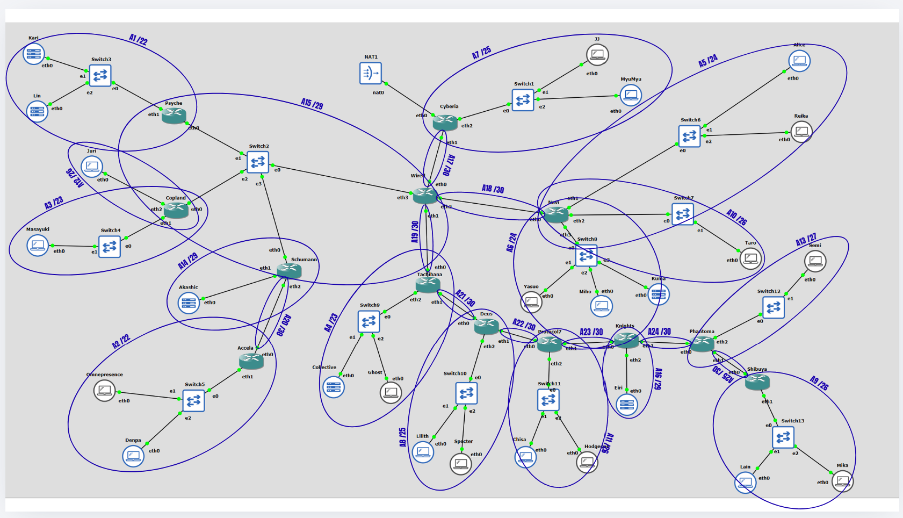

# Jarkom-Modul-4-2026-K-56

| No  | Nama                           | NRP        | Pengerjaan |
| --- | ------------------------------ | ---------- | ---------- |
| 1   | Sahira Bilqis Rivadito         | 5027251037 | CPT + VLSM |
| 2   | Muhammmad Ridwan               | 5027251113 | GNS3 + CIDR|

kita testing dulu bos

BOSS INI BLOM DI UPDATE BOSS OAWOKWOKOWAW

# Laporan Praktikum Modul 4 - Subnetting dan Routing (CIDR, GNS3)

| | |
|---|---|
| Prefix IP | `192.239.0.0` |

## Daftar Isi

- [Ringkasan Soal](#ringkasan-soal)
- [Topologi](#topologi)
- [Kebutuhan IP per Subnet](#kebutuhan-ip-per-subnet)
- [Penggabungan CIDR](#penggabungan-cidr)
- [Pembagian IP](#pembagian-ip)
- [Alamat Interface Router](#alamat-interface-router)
- [Routing](#routing)
- [Konfigurasi GNS3](#konfigurasi-gns3)
- [Pengujian](#pengujian)
- [Analisis Efisiensi](#analisis-efisiensi)

## Ringkasan Soal

- Hanya router **Cyberia** yang terhubung ke NAT. Semua lalu lintas keluar-masuk lewat Cyberia.
- Jumlah IP tiap subnet = jumlah host + jumlah interface router pada subnet tersebut.
- Pembagian IP dan routing harus seefisien mungkin, dan semua node harus bisa saling ping.
- Pada GNS3 dipakai metode **CIDR**; pada CPT metode berbeda (VLSM).

## Topologi



Topologi berbentuk pohon dengan Cyberia sebagai akar:

- Cyberia terhubung ke NAT, Switch1 (JJ, MyuMyu), dan Wired.
- Wired bercabang ke Navi, Tachibana, dan satu segmen bersama (Switch2) milik Psyche, Copland, dan Schumann.
- Schumann meneruskan ke Accela. Tachibana meneruskan ke Deus, lalu Protocol7, Knights, Phantoma, dan Shibuya.
- Total ada 25 subnet: 16 subnet LAN/segmen dan 9 subnet link antar router.

## Kebutuhan IP per Subnet

| Subnet | Letak | Jumlah IP | Netmask | Host usable | Total alamat |
|---|---|---|---|---|---|
| A1 | Psyche - Switch3 (Kari, Lin) | 881 | /22 | 1022 | 1024 |
| A2 | Accela - Switch5 (Omnipresence, Denpa) | 514 | /22 | 1022 | 1024 |
| A3 | Copland - Switch4 (Masayuki) | 301 | /23 | 510 | 512 |
| A4 | Tachibana - Switch9 (Collective, Ghost) | 267 | /23 | 510 | 512 |
| A5 | Navi - Switch6 (Alice, Reika) | 254 | /24 | 254 | 256 |
| A6 | Navi - Switch8 (Yasuo, Miho, Kuma) | 143 | /24 | 254 | 256 |
| A7 | Cyberia - Switch1 (JJ, MyuMyu) | 126 | /25 | 126 | 128 |
| A8 | Deus - Switch10 (Lilith, Specter) | 99 | /25 | 126 | 128 |
| A9 | Shibuya - Switch13 (Lain, Mika) | 62 | /26 | 62 | 64 |
| A10 | Navi - Switch7 (Taro) | 58 | /26 | 62 | 64 |
| A11 | Protocol7 - Switch11 (Chisa, Hodgeson) | 33 | /26 | 62 | 64 |
| A12 | Copland - Juri | 32 | /26 | 62 | 64 |
| A13 | Phantoma - Switch12 (Semi) | 15 | /27 | 30 | 32 |
| A14 | Schumann - Akashic | 4 | /29 | 6 | 8 |
| A15 | Wired - Switch2 - Psyche/Copland/Schumann | 4 | /29 | 6 | 8 |
| A16 | Knights - Eiri | 3 | /29 | 6 | 8 |
| A17 | Cyberia - Wired | 2 | /30 | 2 | 4 |
| A18 | Wired - Navi | 2 | /30 | 2 | 4 |
| A19 | Wired - Tachibana | 2 | /30 | 2 | 4 |
| A20 | Schumann - Accela | 2 | /30 | 2 | 4 |
| A21 | Tachibana - Deus | 2 | /30 | 2 | 4 |
| A22 | Deus - Protocol7 | 2 | /30 | 2 | 4 |
| A23 | Protocol7 - Knights | 2 | /30 | 2 | 4 |
| A24 | Knights - Phantoma | 2 | /30 | 2 | 4 |
| A25 | Phantoma - Shibuya | 2 | /30 | 2 | 4 |
| **Total** | | **2814** | | | **4188** |

Netmask dipilih sebagai blok terkecil yang cukup untuk jumlah IP ditambah alamat network dan broadcast.

## Penggabungan CIDR

Metode: subnet digabung dari yang **terjauh dari Cyberia** menuju ke atas. Netmask hasil gabungan adalah satu tingkat di atas netmask subnet terbesar yang digabung. Subnet kecil digabung dengan subnet kecil dulu agar blok tidak membengkak.

| Blok | Label | Gabungan dari | Netmask akhir | NID blok |
|---|---|---|---|---|
| G1 | Blok Shibuya | A9 /26 + A25 /30 | /25 | 192.239.0.0/25 |
| G2 | Blok Phantoma (kecil) | A13 /27 + A24 /30 | /26 | 192.239.0.128/26 |
| G3 | Blok Phantoma | G1 /25 + G2 /26 | /24 | 192.239.0.0/24 |
| G4 | Blok Knights (kecil) | A16 /29 + A23 /30 | /28 | 192.239.1.0/28 |
| G5 | Blok Knights | G3 /24 + G4 /28 | /23 | 192.239.0.0/23 |
| G6 | Blok Protocol7 (kecil) | A11 /26 + A22 /30 | /25 | 192.239.2.0/25 |
| G7 | Blok Protocol7 | G5 /23 + G6 /25 | /22 | 192.239.0.0/22 |
| G8 | Blok Deus (kecil) | A8 /25 + A21 /30 | /24 | 192.239.4.0/24 |
| G9 | Blok Deus | G7 /22 + G8 /24 | /21 | 192.239.0.0/21 |
| G10 | Blok Tachibana (kecil) | A4 /23 + A19 /30 | /22 | 192.239.8.0/22 |
| G11 | Blok Tachibana | G9 /21 + G10 /22 | /20 | 192.239.0.0/20 |
| N1 | Blok Navi (kecil) | A10 /26 + A18 /30 | /25 | 192.239.18.0/25 |
| N2 | Blok Navi (LAN) | A5 /24 + A6 /24 | /23 | 192.239.16.0/23 |
| N3 | Blok Navi | N2 /23 + N1 /25 | /22 | 192.239.16.0/22 |
| P | Sayap Tachibana + Navi | G11 /20 + N3 /22 | /19 | 192.239.0.0/19 |
| S1 | Blok Schumann (kecil) | A14 /29 + A20 /30 | /28 | 192.239.36.0/28 |
| S2 | Blok Schumann | A2 /22 + S1 /28 | /21 | 192.239.32.0/21 |
| C1 | Blok Copland (kecil) | A12 /26 + A15 /29 | /25 | 192.239.46.0/25 |
| C2 | Blok Copland | A3 /23 + C1 /25 | /22 | 192.239.44.0/22 |
| L1 | Blok Psyche + Copland | A1 /22 + C2 /22 | /21 | 192.239.40.0/21 |
| L2 | Sayap kiri | S2 /21 + L1 /21 | /20 | 192.239.32.0/20 |
| F | Blok Cyberia | A7 /25 + A17 /30 | /24 | 192.239.48.0/24 |
| Q | Sayap kiri + Cyberia | L2 /20 + F /24 | /19 | 192.239.32.0/19 |
| ROOT | ROOT (seluruh topologi) | P /19 + Q /19 | /18 | 192.239.0.0/18 |

### Pohon pembagian

```
192.239.0.0/18  ROOT
├── 192.239.0.0/19  Sayap Tachibana + Navi
│   ├── 192.239.0.0/20  Tachibana
│   │   ├── 192.239.0.0/21  Deus
│   │   │   ├── 192.239.0.0/22  Protocol7
│   │   │   │   ├── 192.239.0.0/23  Knights
│   │   │   │   │   ├── 192.239.0.0/24  Phantoma
│   │   │   │   │   │   ├── 192.239.0.0/25  A9 /26 + A25 /30 (Shibuya)
│   │   │   │   │   │   └── 192.239.0.128/26  A13 /27 + A24 /30
│   │   │   │   │   └── 192.239.1.0/28  A16 /29 + A23 /30
│   │   │   │   └── 192.239.2.0/25  A11 /26 + A22 /30
│   │   │   └── 192.239.4.0/24  A8 /25 + A21 /30
│   │   └── 192.239.8.0/22  A4 /23 + A19 /30
│   └── 192.239.16.0/22  Navi
│       ├── 192.239.16.0/23  A5 /24 + A6 /24
│       └── 192.239.18.0/25  A10 /26 + A18 /30
└── 192.239.32.0/19  Sayap kiri + Cyberia
    ├── 192.239.32.0/20  Sayap kiri
    │   ├── 192.239.32.0/21  Schumann
    │   │   ├── 192.239.32.0/22  A2
    │   │   └── 192.239.36.0/28  A14 /29 + A20 /30
    │   └── 192.239.40.0/21  Psyche + Copland
    │       ├── 192.239.40.0/22  A1 (Psyche)
    │       └── 192.239.44.0/22  Copland
    │           ├── 192.239.44.0/23  A3
    │           └── 192.239.46.0/25  A12 /26 + A15 /29
    └── 192.239.48.0/24  Cyberia (A7 /25 + A17 /30)
```

Setiap router hanya perlu **satu rute** ke seluruh blok di belakangnya, karena subnet di belakang router itu sudah tergabung dalam satu blok yang rapat.

## Pembagian IP

| Subnet | Letak | Network ID | Netmask | Broadcast | Range host |
|---|---|---|---|---|---|
| A1 | Psyche - Switch3 (Kari, Lin) | 192.239.40.0/22 | 255.255.252.0 | 192.239.43.255 | 192.239.40.1 - 192.239.43.254 |
| A2 | Accela - Switch5 (Omnipresence, Denpa) | 192.239.32.0/22 | 255.255.252.0 | 192.239.35.255 | 192.239.32.1 - 192.239.35.254 |
| A3 | Copland - Switch4 (Masayuki) | 192.239.44.0/23 | 255.255.254.0 | 192.239.45.255 | 192.239.44.1 - 192.239.45.254 |
| A4 | Tachibana - Switch9 (Collective, Ghost) | 192.239.8.0/23 | 255.255.254.0 | 192.239.9.255 | 192.239.8.1 - 192.239.9.254 |
| A5 | Navi - Switch6 (Alice, Reika) | 192.239.16.0/24 | 255.255.255.0 | 192.239.16.255 | 192.239.16.1 - 192.239.16.254 |
| A6 | Navi - Switch8 (Yasuo, Miho, Kuma) | 192.239.17.0/24 | 255.255.255.0 | 192.239.17.255 | 192.239.17.1 - 192.239.17.254 |
| A7 | Cyberia - Switch1 (JJ, MyuMyu) | 192.239.48.0/25 | 255.255.255.128 | 192.239.48.127 | 192.239.48.1 - 192.239.48.126 |
| A8 | Deus - Switch10 (Lilith, Specter) | 192.239.4.0/25 | 255.255.255.128 | 192.239.4.127 | 192.239.4.1 - 192.239.4.126 |
| A9 | Shibuya - Switch13 (Lain, Mika) | 192.239.0.0/26 | 255.255.255.192 | 192.239.0.63 | 192.239.0.1 - 192.239.0.62 |
| A10 | Navi - Switch7 (Taro) | 192.239.18.0/26 | 255.255.255.192 | 192.239.18.63 | 192.239.18.1 - 192.239.18.62 |
| A11 | Protocol7 - Switch11 (Chisa, Hodgeson) | 192.239.2.0/26 | 255.255.255.192 | 192.239.2.63 | 192.239.2.1 - 192.239.2.62 |
| A12 | Copland - Juri | 192.239.46.0/26 | 255.255.255.192 | 192.239.46.63 | 192.239.46.1 - 192.239.46.62 |
| A13 | Phantoma - Switch12 (Semi) | 192.239.0.128/27 | 255.255.255.224 | 192.239.0.159 | 192.239.0.129 - 192.239.0.158 |
| A14 | Schumann - Akashic | 192.239.36.0/29 | 255.255.255.248 | 192.239.36.7 | 192.239.36.1 - 192.239.36.6 |
| A15 | Wired - Switch2 - Psyche/Copland/Schumann | 192.239.46.64/29 | 255.255.255.248 | 192.239.46.71 | 192.239.46.65 - 192.239.46.70 |
| A16 | Knights - Eiri | 192.239.1.0/29 | 255.255.255.248 | 192.239.1.7 | 192.239.1.1 - 192.239.1.6 |
| A17 | Cyberia - Wired | 192.239.48.128/30 | 255.255.255.252 | 192.239.48.131 | 192.239.48.129 - 192.239.48.130 |
| A18 | Wired - Navi | 192.239.18.64/30 | 255.255.255.252 | 192.239.18.67 | 192.239.18.65 - 192.239.18.66 |
| A19 | Wired - Tachibana | 192.239.10.0/30 | 255.255.255.252 | 192.239.10.3 | 192.239.10.1 - 192.239.10.2 |
| A20 | Schumann - Accela | 192.239.36.8/30 | 255.255.255.252 | 192.239.36.11 | 192.239.36.9 - 192.239.36.10 |
| A21 | Tachibana - Deus | 192.239.4.128/30 | 255.255.255.252 | 192.239.4.131 | 192.239.4.129 - 192.239.4.130 |
| A22 | Deus - Protocol7 | 192.239.2.64/30 | 255.255.255.252 | 192.239.2.67 | 192.239.2.65 - 192.239.2.66 |
| A23 | Protocol7 - Knights | 192.239.1.8/30 | 255.255.255.252 | 192.239.1.11 | 192.239.1.9 - 192.239.1.10 |
| A24 | Knights - Phantoma | 192.239.0.160/30 | 255.255.255.252 | 192.239.0.163 | 192.239.0.161 - 192.239.0.162 |
| A25 | Phantoma - Shibuya | 192.239.0.64/30 | 255.255.255.252 | 192.239.0.67 | 192.239.0.65 - 192.239.0.66 |

## Alamat Interface Router

| Router | Interface | IP | Netmask | Subnet | Terhubung ke |
|---|---|---|---|---|---|
| Cyberia | eth0 | DHCP | - | - | NAT1 |
| Cyberia | eth1 | 192.239.48.129 | 255.255.255.252 | A17 | Wired eth0 |
| Cyberia | eth2 | 192.239.48.1 | 255.255.255.128 | A7 | Switch1 (JJ, MyuMyu) |
| Wired | eth0 | 192.239.48.130 | 255.255.255.252 | A17 | Cyberia eth1 |
| Wired | eth1 | 192.239.10.1 | 255.255.255.252 | A19 | Tachibana eth0 |
| Wired | eth2 | 192.239.18.65 | 255.255.255.252 | A18 | Navi eth0 |
| Wired | eth3 | 192.239.46.65 | 255.255.255.248 | A15 | Switch2 |
| Navi | eth0 | 192.239.18.66 | 255.255.255.252 | A18 | Wired eth2 |
| Navi | eth1 | 192.239.16.1 | 255.255.255.0 | A5 | Switch6 (Alice, Reika) |
| Navi | eth2 | 192.239.18.1 | 255.255.255.192 | A10 | Switch7 (Taro) |
| Navi | eth3 | 192.239.17.1 | 255.255.255.0 | A6 | Switch8 (Yasuo, Miho, Kuma) |
| Tachibana | eth0 | 192.239.10.2 | 255.255.255.252 | A19 | Wired eth1 |
| Tachibana | eth1 | 192.239.4.129 | 255.255.255.252 | A21 | Deus eth0 |
| Tachibana | eth2 | 192.239.8.1 | 255.255.254.0 | A4 | Switch9 (Collective, Ghost) |
| Deus | eth0 | 192.239.4.130 | 255.255.255.252 | A21 | Tachibana eth1 |
| Deus | eth1 | 192.239.2.65 | 255.255.255.252 | A22 | Protocol7 eth0 |
| Deus | eth2 | 192.239.4.1 | 255.255.255.128 | A8 | Switch10 (Lilith, Specter) |
| Protocol7 | eth0 | 192.239.2.66 | 255.255.255.252 | A22 | Deus eth1 |
| Protocol7 | eth1 | 192.239.1.9 | 255.255.255.252 | A23 | Knights eth0 |
| Protocol7 | eth2 | 192.239.2.1 | 255.255.255.192 | A11 | Switch11 (Chisa, Hodgeson) |
| Knights | eth0 | 192.239.1.10 | 255.255.255.252 | A23 | Protocol7 eth1 |
| Knights | eth1 | 192.239.0.161 | 255.255.255.252 | A24 | Phantoma eth0 |
| Knights | eth2 | 192.239.1.1 | 255.255.255.248 | A16 | Eiri |
| Phantoma | eth0 | 192.239.0.162 | 255.255.255.252 | A24 | Knights eth1 |
| Phantoma | eth1 | 192.239.0.65 | 255.255.255.252 | A25 | Shibuya eth0 |
| Phantoma | eth2 | 192.239.0.129 | 255.255.255.224 | A13 | Switch12 (Semi) |
| Shibuya | eth0 | 192.239.0.66 | 255.255.255.252 | A25 | Phantoma eth1 |
| Shibuya | eth1 | 192.239.0.1 | 255.255.255.192 | A9 | Switch13 (Lain, Mika) |
| Psyche | eth0 | 192.239.46.66 | 255.255.255.248 | A15 | Switch2 |
| Psyche | eth1 | 192.239.40.1 | 255.255.252.0 | A1 | Switch3 (Kari, Lin) |
| Copland | eth0 | 192.239.46.67 | 255.255.255.248 | A15 | Switch2 |
| Copland | eth1 | 192.239.44.1 | 255.255.254.0 | A3 | Switch4 (Masayuki) |
| Copland | eth2 | 192.239.46.1 | 255.255.255.192 | A12 | Juri |
| Schumann | eth0 | 192.239.46.68 | 255.255.255.248 | A15 | Switch2 |
| Schumann | eth1 | 192.239.36.1 | 255.255.255.248 | A14 | Akashic |
| Schumann | eth2 | 192.239.36.9 | 255.255.255.252 | A20 | Accela eth0 |
| Accela | eth0 | 192.239.36.10 | 255.255.255.252 | A20 | Schumann eth2 |
| Accela | eth1 | 192.239.32.1 | 255.255.252.0 | A2 | Switch5 (Omnipresence, Denpa) |

## Routing

Routing yang dipakai adalah **static routing** dengan dua jenis rute:

1. **Default route** ke router di atasnya (arah Cyberia), supaya semua tujuan yang tidak dikenal naik ke atas.
2. **Satu rute ringkasan** ke blok CIDR di belakang tiap router yang punya router di bawahnya.

Total **24 entri** rute statis.

| Router | Tujuan | Via |
|---|---|---|
| Cyberia | 192.239.0.0/18 | 192.239.48.130 |
| Wired | default | 192.239.48.129 |
| Wired | 192.239.0.0/20 | 192.239.10.2 |
| Wired | 192.239.16.0/22 | 192.239.18.66 |
| Wired | 192.239.32.0/21 | 192.239.46.68 |
| Wired | 192.239.40.0/22 | 192.239.46.66 |
| Wired | 192.239.44.0/22 | 192.239.46.67 |
| Navi | default | 192.239.18.65 |
| Tachibana | default | 192.239.10.1 |
| Tachibana | 192.239.0.0/21 | 192.239.4.130 |
| Deus | default | 192.239.4.129 |
| Deus | 192.239.0.0/22 | 192.239.2.66 |
| Protocol7 | default | 192.239.2.65 |
| Protocol7 | 192.239.0.0/23 | 192.239.1.10 |
| Knights | default | 192.239.1.9 |
| Knights | 192.239.0.0/24 | 192.239.0.162 |
| Phantoma | default | 192.239.0.161 |
| Phantoma | 192.239.0.0/25 | 192.239.0.66 |
| Shibuya | default | 192.239.0.65 |
| Psyche | default | 192.239.46.65 |
| Copland | default | 192.239.46.65 |
| Schumann | default | 192.239.46.65 |
| Schumann | 192.239.32.0/22 | 192.239.36.10 |
| Accela | default | 192.239.36.9 |
| Cyberia | default | otomatis dari DHCP NAT1 |

Wired memerlukan tiga rute terpisah ke Psyche, Copland, dan Schumann karena ketiganya berada pada segmen yang sama dengan next hop berbeda.

## Konfigurasi GNS3

Konfigurasi dimasukkan lewat *Edit Network Configuration* pada tiap node, lalu node di-restart.

<details>
<summary>Konfigurasi 13 router</summary>

### Cyberia

```
# eth0 -> NAT1
auto eth0
iface eth0 inet dhcp

# eth1 -> Wired eth0 (A17)
auto eth1
iface eth1 inet static
    address 192.239.48.129
    netmask 255.255.255.252
    up ip route add 192.239.0.0/18 via 192.239.48.130

# eth2 -> Switch1 (JJ, MyuMyu) (A7)
auto eth2
iface eth2 inet static
    address 192.239.48.1
    netmask 255.255.255.128

```

### Wired

```
# eth0 -> Cyberia eth1 (A17)
auto eth0
iface eth0 inet static
    address 192.239.48.130
    netmask 255.255.255.252
    up ip route add default via 192.239.48.129

# eth1 -> Tachibana eth0 (A19)
auto eth1
iface eth1 inet static
    address 192.239.10.1
    netmask 255.255.255.252
    up ip route add 192.239.0.0/20 via 192.239.10.2

# eth2 -> Navi eth0 (A18)
auto eth2
iface eth2 inet static
    address 192.239.18.65
    netmask 255.255.255.252
    up ip route add 192.239.16.0/22 via 192.239.18.66

# eth3 -> Switch2 (A15)
auto eth3
iface eth3 inet static
    address 192.239.46.65
    netmask 255.255.255.248
    up ip route add 192.239.32.0/21 via 192.239.46.68
    up ip route add 192.239.40.0/22 via 192.239.46.66
    up ip route add 192.239.44.0/22 via 192.239.46.67

```

### Navi

```
# eth0 -> Wired eth2 (A18)
auto eth0
iface eth0 inet static
    address 192.239.18.66
    netmask 255.255.255.252
    up ip route add default via 192.239.18.65

# eth1 -> Switch6 (Alice, Reika) (A5)
auto eth1
iface eth1 inet static
    address 192.239.16.1
    netmask 255.255.255.0

# eth2 -> Switch7 (Taro) (A10)
auto eth2
iface eth2 inet static
    address 192.239.18.1
    netmask 255.255.255.192

# eth3 -> Switch8 (Yasuo, Miho, Kuma) (A6)
auto eth3
iface eth3 inet static
    address 192.239.17.1
    netmask 255.255.255.0

```

### Tachibana

```
# eth0 -> Wired eth1 (A19)
auto eth0
iface eth0 inet static
    address 192.239.10.2
    netmask 255.255.255.252
    up ip route add default via 192.239.10.1

# eth1 -> Deus eth0 (A21)
auto eth1
iface eth1 inet static
    address 192.239.4.129
    netmask 255.255.255.252
    up ip route add 192.239.0.0/21 via 192.239.4.130

# eth2 -> Switch9 (Collective, Ghost) (A4)
auto eth2
iface eth2 inet static
    address 192.239.8.1
    netmask 255.255.254.0

```

### Deus

```
# eth0 -> Tachibana eth1 (A21)
auto eth0
iface eth0 inet static
    address 192.239.4.130
    netmask 255.255.255.252
    up ip route add default via 192.239.4.129

# eth1 -> Protocol7 eth0 (A22)
auto eth1
iface eth1 inet static
    address 192.239.2.65
    netmask 255.255.255.252
    up ip route add 192.239.0.0/22 via 192.239.2.66

# eth2 -> Switch10 (Lilith, Specter) (A8)
auto eth2
iface eth2 inet static
    address 192.239.4.1
    netmask 255.255.255.128

```

### Protocol7

```
# eth0 -> Deus eth1 (A22)
auto eth0
iface eth0 inet static
    address 192.239.2.66
    netmask 255.255.255.252
    up ip route add default via 192.239.2.65

# eth1 -> Knights eth0 (A23)
auto eth1
iface eth1 inet static
    address 192.239.1.9
    netmask 255.255.255.252
    up ip route add 192.239.0.0/23 via 192.239.1.10

# eth2 -> Switch11 (Chisa, Hodgeson) (A11)
auto eth2
iface eth2 inet static
    address 192.239.2.1
    netmask 255.255.255.192

```

### Knights

```
# eth0 -> Protocol7 eth1 (A23)
auto eth0
iface eth0 inet static
    address 192.239.1.10
    netmask 255.255.255.252
    up ip route add default via 192.239.1.9

# eth1 -> Phantoma eth0 (A24)
auto eth1
iface eth1 inet static
    address 192.239.0.161
    netmask 255.255.255.252
    up ip route add 192.239.0.0/24 via 192.239.0.162

# eth2 -> Eiri (A16)
auto eth2
iface eth2 inet static
    address 192.239.1.1
    netmask 255.255.255.248

```

### Phantoma

```
# eth0 -> Knights eth1 (A24)
auto eth0
iface eth0 inet static
    address 192.239.0.162
    netmask 255.255.255.252
    up ip route add default via 192.239.0.161

# eth1 -> Shibuya eth0 (A25)
auto eth1
iface eth1 inet static
    address 192.239.0.65
    netmask 255.255.255.252
    up ip route add 192.239.0.0/25 via 192.239.0.66

# eth2 -> Switch12 (Semi) (A13)
auto eth2
iface eth2 inet static
    address 192.239.0.129
    netmask 255.255.255.224

```

### Shibuya

```
# eth0 -> Phantoma eth1 (A25)
auto eth0
iface eth0 inet static
    address 192.239.0.66
    netmask 255.255.255.252
    up ip route add default via 192.239.0.65

# eth1 -> Switch13 (Lain, Mika) (A9)
auto eth1
iface eth1 inet static
    address 192.239.0.1
    netmask 255.255.255.192

```

### Psyche

```
# eth0 -> Switch2 (A15)
auto eth0
iface eth0 inet static
    address 192.239.46.66
    netmask 255.255.255.248
    up ip route add default via 192.239.46.65

# eth1 -> Switch3 (Kari, Lin) (A1)
auto eth1
iface eth1 inet static
    address 192.239.40.1
    netmask 255.255.252.0

```

### Copland

```
# eth0 -> Switch2 (A15)
auto eth0
iface eth0 inet static
    address 192.239.46.67
    netmask 255.255.255.248
    up ip route add default via 192.239.46.65

# eth1 -> Switch4 (Masayuki) (A3)
auto eth1
iface eth1 inet static
    address 192.239.44.1
    netmask 255.255.254.0

# eth2 -> Juri (A12)
auto eth2
iface eth2 inet static
    address 192.239.46.1
    netmask 255.255.255.192

```

### Schumann

```
# eth0 -> Switch2 (A15)
auto eth0
iface eth0 inet static
    address 192.239.46.68
    netmask 255.255.255.248
    up ip route add default via 192.239.46.65

# eth1 -> Akashic (A14)
auto eth1
iface eth1 inet static
    address 192.239.36.1
    netmask 255.255.255.248

# eth2 -> Accela eth0 (A20)
auto eth2
iface eth2 inet static
    address 192.239.36.9
    netmask 255.255.255.252
    up ip route add 192.239.32.0/22 via 192.239.36.10

```

### Accela

```
# eth0 -> Schumann eth2 (A20)
auto eth0
iface eth0 inet static
    address 192.239.36.10
    netmask 255.255.255.252
    up ip route add default via 192.239.36.9

# eth1 -> Switch5 (Omnipresence, Denpa) (A2)
auto eth1
iface eth1 inet static
    address 192.239.32.1
    netmask 255.255.252.0

```

</details>

<details>
<summary>Konfigurasi host</summary>

Format sama untuk semua host (ganti nilai sesuai tabel):

```
auto eth0
iface eth0 inet static
    address <IP>
    netmask <NETMASK>
    gateway <GATEWAY>
```

| Host | Subnet | IP | Netmask | Gateway |
|---|---|---|---|---|
| Kari | A1 | 192.239.40.2 | 255.255.252.0 | 192.239.40.1 |
| Lin | A1 | 192.239.40.3 | 255.255.252.0 | 192.239.40.1 |
| Omnipresence | A2 | 192.239.32.2 | 255.255.252.0 | 192.239.32.1 |
| Denpa | A2 | 192.239.32.3 | 255.255.252.0 | 192.239.32.1 |
| Masayuki | A3 | 192.239.44.2 | 255.255.254.0 | 192.239.44.1 |
| Collective | A4 | 192.239.8.2 | 255.255.254.0 | 192.239.8.1 |
| Ghost | A4 | 192.239.8.3 | 255.255.254.0 | 192.239.8.1 |
| Alice | A5 | 192.239.16.2 | 255.255.255.0 | 192.239.16.1 |
| Reika | A5 | 192.239.16.3 | 255.255.255.0 | 192.239.16.1 |
| Yasuo | A6 | 192.239.17.2 | 255.255.255.0 | 192.239.17.1 |
| Miho | A6 | 192.239.17.3 | 255.255.255.0 | 192.239.17.1 |
| Kuma | A6 | 192.239.17.4 | 255.255.255.0 | 192.239.17.1 |
| JJ | A7 | 192.239.48.2 | 255.255.255.128 | 192.239.48.1 |
| MyuMyu | A7 | 192.239.48.3 | 255.255.255.128 | 192.239.48.1 |
| Lilith | A8 | 192.239.4.2 | 255.255.255.128 | 192.239.4.1 |
| Specter | A8 | 192.239.4.3 | 255.255.255.128 | 192.239.4.1 |
| Lain | A9 | 192.239.0.2 | 255.255.255.192 | 192.239.0.1 |
| Mika | A9 | 192.239.0.3 | 255.255.255.192 | 192.239.0.1 |
| Taro | A10 | 192.239.18.2 | 255.255.255.192 | 192.239.18.1 |
| Chisa | A11 | 192.239.2.2 | 255.255.255.192 | 192.239.2.1 |
| Hodgeson | A11 | 192.239.2.3 | 255.255.255.192 | 192.239.2.1 |
| Juri | A12 | 192.239.46.2 | 255.255.255.192 | 192.239.46.1 |
| Semi | A13 | 192.239.0.130 | 255.255.255.224 | 192.239.0.129 |
| Akashic | A14 | 192.239.36.2 | 255.255.255.248 | 192.239.36.1 |
| Eiri | A16 | 192.239.1.2 | 255.255.255.248 | 192.239.1.1 |

</details>

## Pengujian

Setelah semua node di-start, dicek `ip a` dan `ip route` di tiap router, lalu dilakukan ping antar node pada cabang berbeda.

| No | Dari | Tujuan | IP tujuan | Hasil |
|---|---|---|---|---|
| 1 | Lain | Kari | 192.239.40.2 | [isi: berhasil/gagal] |
| 2 | Denpa | JJ | 192.239.48.2 | [isi: berhasil/gagal] |
| 3 | Eiri | Akashic | 192.239.36.2 | [isi: berhasil/gagal] |
| 4 | Kuma | Semi | 192.239.0.130 | [isi: berhasil/gagal] |
| 5 | Alice | Masayuki | 192.239.44.2 | [isi: berhasil/gagal] |
| 6 | Ghost | MyuMyu | 192.239.48.3 | [isi: berhasil/gagal] |
| 7 | Chisa | Mika | 192.239.0.3 | [isi: berhasil/gagal] |
| 8 | Taro | Lilith | 192.239.4.2 | [isi: berhasil/gagal] |

Contoh bukti pengujian (ganti dengan screenshot sendiri):


Jalur yang diharapkan dari Lain ke Kari: Shibuya, Phantoma, Knights, Protocol7, Deus, Tachibana, Wired, Psyche, lalu Kari.

## Analisis Efisiensi

- **Pembagian IP:** seluruh topologi muat dalam satu blok `192.239.0.0/18`. Root /18 adalah hasil penggabungan CIDR menurut aturan modul; total alamat seluruh subnet (4188) sebenarnya muat di /19, yang akan menjadi root jika memakai VLSM. Pemakaian blok /18 sekitar 26%.
- **Routing:** hanya 24 entri statis untuk 13 router. Tiap router punya satu default route dan paling banyak satu rute ringkasan ke blok di bawahnya; hanya Wired yang memerlukan lebih (5 rute spesifik).
- **Trade-off CIDR:** blok yang terbentuk lebih besar daripada VLSM karena setiap penggabungan menaikkan netmask satu tingkat, sehingga ada alamat tidak terpakai di dalam blok. Sebagai gantinya, tabel routing lebih sederhana dan penambahan subnet baru biasanya tidak memerlukan perhitungan ulang.
- **Urutan penggabungan:** subnet kecil digabung dengan subnet kecil lebih dulu, baru dengan blok besar. Cara ini mencegah blok membengkak berlipat pada rantai Tachibana - Deus - Protocol7 - Knights - Phantoma - Shibuya.

## Struktur Repositori

```
.
├── README.md          laporan ini
└── assets/
    ├── topologi-gns3.png
    ├── ping-lain-kari.png
    ├── traceroute-lain-kari.png
    └── route-wired.png
```
